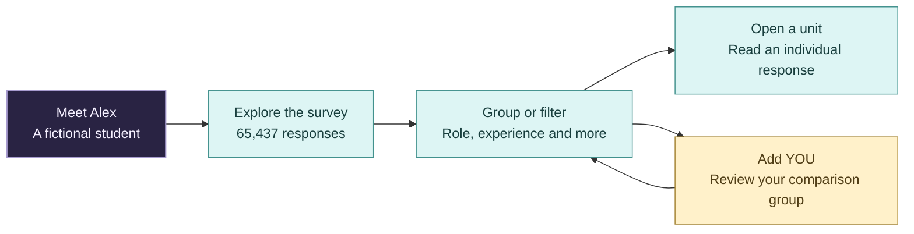
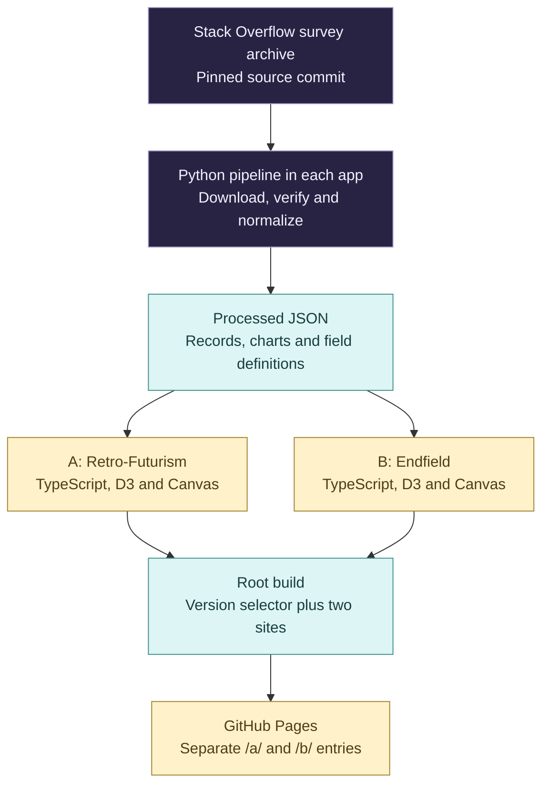

<div align="center">

# Where Do We Stand?

### A developer survey gets personal.


**English | [简体中文](README.zh-CN.md)**

[Choose a version](https://cloviszhu.github.io/Where-Do-We-Stand/) · [A: Retro-Futurism](https://cloviszhu.github.io/Where-Do-We-Stand/a/) · [B: Endfield](https://cloviszhu.github.io/Where-Do-We-Stand/b/)

</div>

Where do students and new developers fit in the wider profession? What changes when you look at experience, pay or AI use?

Start with Alex, a fictional student. Then step into the survey and find a comparison group of your own. Where Do We Stand? connects a guided data story to an explorer containing all **65,437 anonymous responses from the 2024 Stack Overflow Developer Survey**. You can inspect the actual answers behind a group.

## Pick the experience

<table>
<tr>
<th width="50%">A · Retro-Futurism</th>
<th width="50%">B · Endfield</th>
</tr>
<tr>
<td>Night purple, pink and cyan. A scrolling story moves from Alex into an animated crowd, with chapter stops and a separate route into free exploration.</td>
<td>Grey figures and yellow emphasis. Seven story scenes sit under six chapter tabs, with light and dark themes and an archive built around individual records.</td>
</tr>
<tr>
<td><a href="https://cloviszhu.github.io/Where-Do-We-Stand/a/"><strong>Enter A</strong></a> · <a href="prototypes/people/">Read the source</a></td>
<td><a href="https://cloviszhu.github.io/Where-Do-We-Stand/b/"><strong>Enter B</strong></a> · <a href="prototypes/archives/">Read the source</a></td>
</tr>
</table>

Each version is a complete application with its own interface, data definitions and build. They share a repository and version selector.

## From one person to the wider picture



| In the interface | Why it's there |
| --- | --- |
| Figures that open into records | Each overview figure groups up to 50 responses. You can select its members or use the record list to inspect individuals. |
| Grouping and filtering as separate actions | Grouping rearranges the records. Filtering changes which records belong to the visible sample. |
| A YOU marker with explicit conditions | Review your profile before placing it. Current attributes define the comparison group; a future role or goal doesn't enter the matching criteria. |
| Context beside the charts | Sample sizes, exclusions and field definitions sit with the views. Text tables provide another way to read the values. |

Alex and YOU are illustrative markers. Neither enters the survey counts. Profile inputs stay in page memory and clear on refresh.

## Run locally

Use **Node.js 24+** and npm. Processed data is already included; you don't need to download the original CSVs to explore the site.

```sh
git clone https://github.com/cloviszhu/Where-Do-We-Stand.git
cd Where-Do-We-Stand
npm run install:sites
```

Choose a development server:

```sh
# A: Retro-Futurism
npm run dev --prefix prototypes/people

# B: Endfield, in a separate terminal
npm run dev --prefix prototypes/archives
```

Open the address printed by Vite. Use HTTP, because opening an HTML file directly won't load the modules and data correctly.

<details>
<summary><strong>How the data reaches the screen</strong></summary>



Each app keeps its own processed files and source manifest. The diagram shows the common pipeline; it doesn't imply a shared runtime dataset.

| Source | Focus |
| --- | --- |
| [prototypes/people/src/](prototypes/people/src/) | A's chapters, crowd and D3 charts |
| [prototypes/archives/src/](prototypes/archives/src/) | B's scene routing, archive and profile matching |
| [A source manifest](prototypes/people/data/sources.json) / [B source manifest](prototypes/archives/data/sources.json) | Source URLs, retrieval records and hashes |
| [A data scripts](prototypes/people/scripts/) / [B data scripts](prototypes/archives/scripts/) | Download, transformation and validation |
| [scripts/build-pages.mjs](scripts/build-pages.mjs) | Version selector and combined static output |

To rebuild from original inputs, use Python 3.10+ and run the following inside the chosen prototype directory. The download is about 459 MB.

```sh
python scripts/download_data.py
python scripts/build_data.py
python scripts/validate_data.py
```

</details>

<details>
<summary><strong>Sample definitions and the limits of a comparison</strong></summary>

Both explorers retain the full 2024 response set. Charts use their own valid-response subsets and disclosed denominators. Explorer filters don't rewrite the story charts.

A uses 2024 for its main people, peers, pay and language views. B's language comparison uses 2025. Both use separate annual samples for the 2023–2025 AI trend and 2025 for AI frequency composition. The samples don't track the same people over time.

The 2025 survey has no `YearsCodePro`. Its `WorkExp` field measures a different concept, so the pipeline doesn't substitute it for professional coding experience. Missing values remain visible in the data notes.

These are self-selected, self-reported survey responses. They describe the respondents, not every developer. Compensation charts don't predict your salary; language use doesn't measure job openings. A profile match identifies a comparison group, not a career forecast.

</details>

<details>
<summary><strong>Build, checks and deployment</strong></summary>

```sh
npm test
npm run build
```

The root commands test and build both apps. Output includes `dist/index.html`, `dist/a/` and `dist/b/`, with relative asset paths. Serve `dist/` over HTTP for a production preview.

[The Pages workflow](.github/workflows/pages.yml) installs both locked dependency sets, runs their tests and builds, then publishes one artifact. [The deployment record](docs/features/github-pages-ab.md) documents acceptance and recovery. The prototype READMEs contain version-specific verification records; their historical test counts aren't a claim about a new run.

Keyboard controls, text tables and system reduced-motion handling are implemented. Desktop browser emulation doesn't establish physical-phone or screen-reader acceptance.

</details>

## Data credits

Source: [Stack Overflow Developer Survey](https://survey.stackoverflow.co/), with the pinned archive recorded in each app's source manifest. Database rights follow [ODbL 1.0](https://opendatacommons.org/licenses/odbl/1-0/); individual contents follow [DbCL 1.0](https://opendatacommons.org/licenses/dbcl/1-0/).

See the [A notices](prototypes/people/THIRD_PARTY_NOTICES.md), [B data notes](prototypes/archives/README.md#data) and [B dependency licenses](prototypes/archives/public/licenses/) for attribution.
