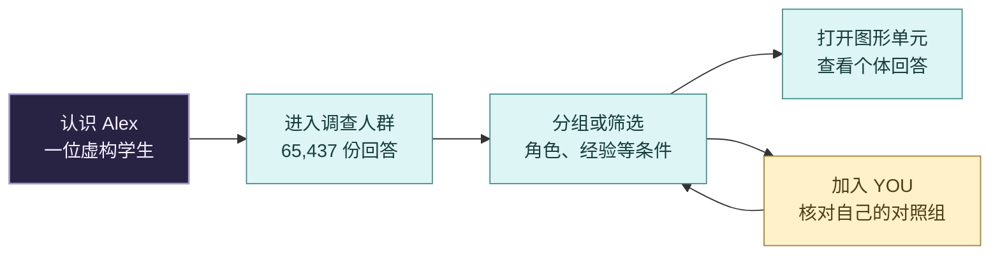
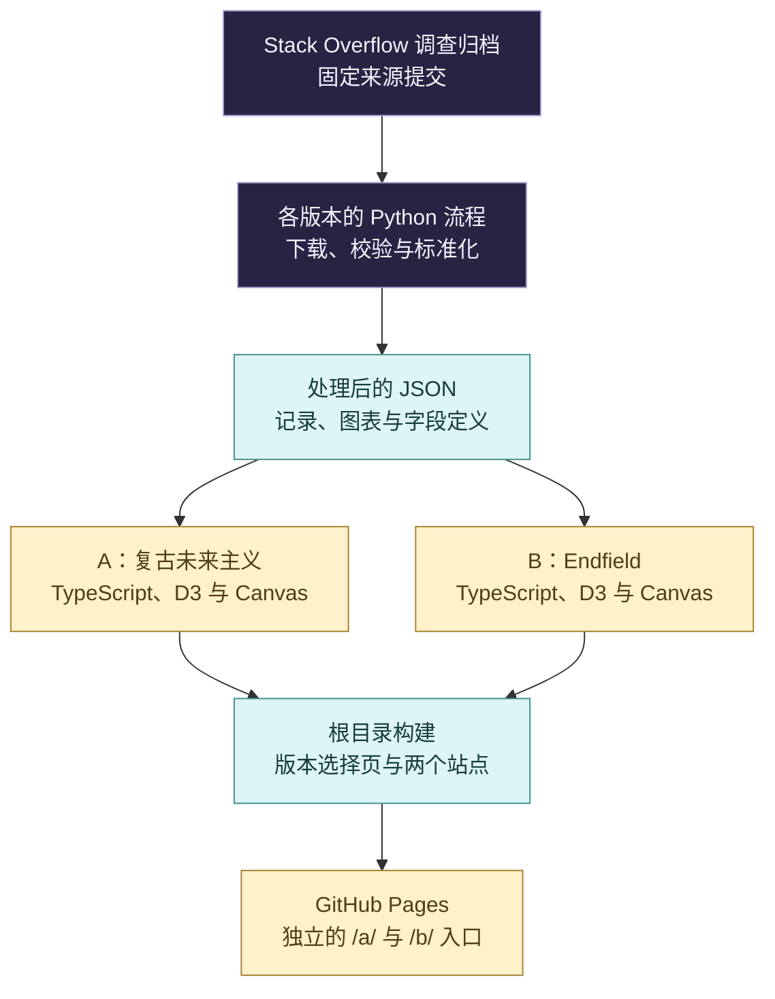

<div align="center">

# Where Do We Stand?

### 从一片人群，看见自己的位置。


**[English](README.md) | 简体中文**

[选择版本](https://cloviszhu.github.io/Where-Do-We-Stand/) · [A：复古未来主义](https://cloviszhu.github.io/Where-Do-We-Stand/a/) · [B：Endfield](https://cloviszhu.github.io/Where-Do-We-Stand/b/)

</div>

计算机专业学生和刚入行的开发者，在整个行业中处于什么位置？换一个经验区间，薪酬和 AI 使用情况又有什么不同？

先认识虚构学生 Alex，再走进调查人群，找到适合自己的对照组。Where Do We Stand? 将引导式数据叙事与自由探索连接起来，保留了 **2024 年 Stack Overflow 开发者调查的全部 65,437 份匿名回答**。看到一个分组后，还能继续查看其中每个人的原始回答。

## 选择一种体验

<table>
<tr>
<th width="50%">A · 复古未来主义</th>
<th width="50%">B · Endfield</th>
</tr>
<tr>
<td>以夜紫、粉色和青色构成画面。滚动叙事从 Alex 进入动态人群，章节停靠控制阅读节奏，也能进入自由探索。</td>
<td>以灰色人形与黄色重点构成画面。六个章节标签下组织七幕故事，支持明暗主题，并通过档案界面查看个体记录。</td>
</tr>
<tr>
<td><a href="https://cloviszhu.github.io/Where-Do-We-Stand/a/"><strong>体验 A 版</strong></a> · <a href="prototypes/people/">查看源码</a></td>
<td><a href="https://cloviszhu.github.io/Where-Do-We-Stand/b/"><strong>体验 B 版</strong></a> · <a href="prototypes/archives/">查看源码</a></td>
</tr>
</table>

两版各自拥有完整界面、数据定义与构建流程，共用仓库和版本选择页。

## 从一个人，走进一片人群



| 界面设计 | 解决的问题 |
| --- | --- |
| 从图形单元展开到个体记录 | 概览中的每个人形聚合最多 50 份回答，可选择成员，也可通过记录列表逐个查看。 |
| 区分分组与筛选 | 分组重新排列记录；筛选改变当前可见样本的范围。 |
| 使用明确条件放置 YOU | 放置前先核对个人资料。当前属性用于寻找对照组，未来目标或期望角色不进入匹配条件。 |
| 把统计口径放在图旁 | 展示样本量、排除项与字段定义，并提供文字表格读取数值。 |

Alex 与 YOU 都是示意标记，不计入调查人数。个人资料仅保存在页面内存中，刷新后清除。

## 本地运行

使用 **Node.js 24+** 和 npm。仓库已经包含处理后的数据，体验网站无需重新下载原始 CSV。

```sh
git clone https://github.com/cloviszhu/Where-Do-We-Stand.git
cd Where-Do-We-Stand
npm run install:sites
```

选择要启动的版本：

```sh
# A：复古未来主义
npm run dev --prefix prototypes/people

# B：Endfield，可在另一个终端运行
npm run dev --prefix prototypes/archives
```

打开 Vite 打印的地址。页面需要通过 HTTP 加载模块与数据，不能直接双击 HTML 文件。

<details>
<summary><strong>数据如何进入界面</strong></summary>



每版各自保留处理后的数据与来源清单。图中概括了相同的处理步骤，两版运行时并不共用一份数据文件。

| 源码 | 阅读重点 |
| --- | --- |
| [prototypes/people/src/](prototypes/people/src/) | A 版章节、人群与 D3 图表 |
| [prototypes/archives/src/](prototypes/archives/src/) | B 版场景路由、档案与个人条件匹配 |
| [A 来源清单](prototypes/people/data/sources.json) / [B 来源清单](prototypes/archives/data/sources.json) | 原始链接、获取记录与校验值 |
| [A 数据脚本](prototypes/people/scripts/) / [B 数据脚本](prototypes/archives/scripts/) | 下载、转换与验证 |
| [scripts/build-pages.mjs](scripts/build-pages.mjs) | 版本选择页与静态产物整合 |

需要从原始数据重建时，在对应原型目录中使用 Python 3.10+ 执行以下命令。下载量约 459 MB。

```sh
python scripts/download_data.py
python scripts/build_data.py
python scripts/validate_data.py
```

</details>

<details>
<summary><strong>样本口径与比较范围</strong></summary>

两个探索器都保留完整的 2024 年回答集。各张图表按自身口径选取有效样本并说明分母；探索器的筛选不会改写叙事图表。

A 版的主要人群、同行、薪酬和语言视图使用 2024 年数据；B 版的语言比较使用 2025 年数据。两版的 AI 趋势使用 2023 至 2025 年独立样本，使用频率构成采用 2025 年数据。跨年样本没有追踪同一批人。

2025 年调查没有 `YearsCodePro` 字段。`WorkExp` 衡量的是另一种工作经验，因此流程没有用它替代专业编程年限。缺失值的处理记录在数据说明中。

调查由受访者自愿参与并自行填报，描述范围限于这些回答。薪酬图不能预测个人工资，语言使用量不能代表招聘需求；个人匹配结果给出的是对照组，不是职业预测。

</details>

<details>
<summary><strong>构建、检查与部署</strong></summary>

```sh
npm test
npm run build
```

根目录命令依次测试并构建两个应用，输出 `dist/index.html`、`dist/a/` 和 `dist/b/`，资源采用相对路径。生产预览需通过 HTTP 服务访问 `dist/`。

[Pages 工作流](.github/workflows/pages.yml)分别安装两版锁定的依赖，执行测试和构建，再发布一个整合产物。[部署记录](docs/features/github-pages-ab.md)保存验收与恢复信息。两版原型 README 中的测试数字属于各自的历史记录，不代表重新运行后的结果。

项目实现了键盘操作、文字表格与系统减少动态效果偏好的处理。桌面浏览器模拟不等于已经完成真机或读屏软件验收。

</details>

## 数据署名

数据来自 [Stack Overflow Developer Survey](https://survey.stackoverflow.co/)，固定归档版本记录在各应用的来源清单中。数据库采用 [ODbL 1.0](https://opendatacommons.org/licenses/odbl/1-0/)，单项内容采用 [DbCL 1.0](https://opendatacommons.org/licenses/dbcl/1-0/)。

具体署名见 [A 版声明](prototypes/people/THIRD_PARTY_NOTICES.md)、[B 版数据说明](prototypes/archives/README.md#data)与 [B 版依赖许可](prototypes/archives/public/licenses/)。
